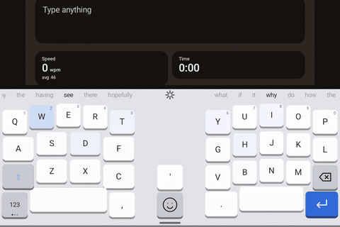
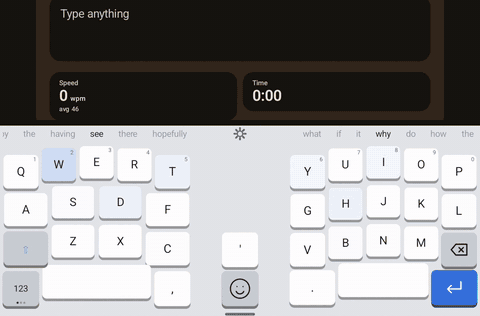
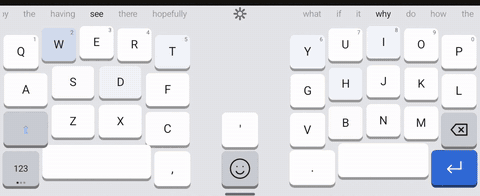
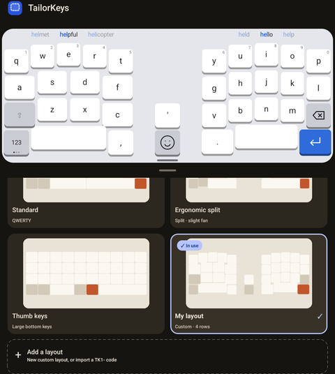
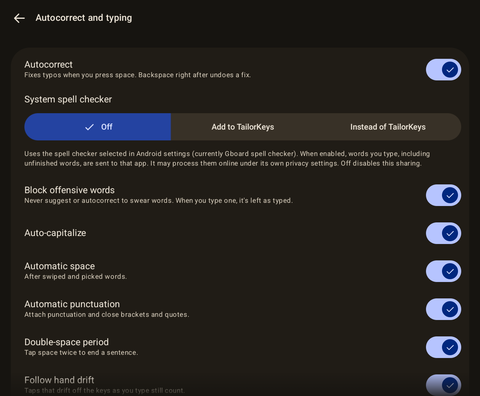

# TailorKeys

## Status

A new autocorrect model is in training. It trains on and off on my own computer: overnight on some nights, and otherwise only while I'm not using the machine, so it is taking a while.

The keyboard works without it in the meantime. Its corrections and suggestions come from its built-in dictionary, a small next-word network for English and the words you type. The demo marked "earlier model" below shows the first autocorrect prototype, which is retired and not included in this repository.

## About

An Android keyboard built around two things stock keyboards get wrong: **size you can actually control**, and **predictions that don't fight you**.

TailorKeys has no internet permission. Its own prediction and correction run on the device. Optional system spell checking sends words to your selected spell-checker app, which may use the internet. Optional dictation uses the selected speech service.

## Demos

The first three clips were recorded on 9 November 2026 on an Android tablet in the keyboard's "Try it" screen. The taps were sent by a script, so the speed counter is not a real typing speed, and the clips are cropped to the text box and the keyboard.

### Suggestion wheels



A few letters of each long word, then a tap on the right-hand wheel: "Barc" becomes Barcelona, "Thur" Thursday, "aftern" afternoon and "cathe" cathedral. The left-hand wheel shows less obvious words. After a space, both wheels offer next words.

### Emoji and kaomoji



The smiley key opens the insert panel: emoji with search and recents, a kaomoji tab, the clipboard and voice typing.

### Quick options: split and themes



The gear between the wheels opens Quick options. Here the split keyboard is joined and split again, then the theme steps through Dark, Midnight, Warm, High contrast and Match system, back to Light.

### Layouts and typing settings

<table>
  <tr>
    <td></td>
    <td></td>
  </tr>
  <tr>
    <td>The layout library, with a live preview</td>
    <td>Autocorrect and typing settings</td>
  </tr>
</table>

### Autocorrect with the earlier model


Earlier model. Typed on a tablet at about 80 words a minute without looking at the keys, in the keyboard's "Try it" screen, with the first autocorrect prototype. Garbled words are fixed a moment later, and some mistakes stay in. That prototype is retired, so builds from this repository use the keyboard's built-in corrector until the new model is ready. What the prototype got wrong, and what it taught us, is in [docs/autocorrect-prototype.md](docs/autocorrect-prototype.md).

## Features

**Typing and suggestions**
- Two suggestion wheels, one per thumb. The right wheel shows the closest matches and the left wheel less obvious words. Tap a word to insert it; after a space the wheels offer next words.
- Autocorrect at the space bar, on by default. Backspace right after a fix undoes it.
- Optional system spell checker: Off, Add to TailorKeys or Instead of TailorKeys. It starts off and is kept on this device only, so restoring a backup never turns it on.
- Swipe typing, on by default, in two styles: guess the word, or type the letters you pass.
- Tidy reviews the last sentence or two around the cursor and lists fixes for misspellings, extra spaces and missing capitals at the start of sentences. You choose which to apply.
- Learns words from what you type. Learning can be paused, learned words can be searched and removed, and blocked corrections can be removed.
- Automatic space after swiped and picked words, automatic punctuation (attaches punctuation and closes brackets and quotes), double-space period, auto-capitals, a block on offensive words, and taps that drift off the keys as your hands move still count.
- Chords (experimental, off by default): press several keys together to type a whole word.

**Layouts and size**
- Layout library with Standard, Ergonomic split and Thumb keys, plus your own layouts. Layouts can be shared and imported as `TK1-` codes, which also work on iOS.
- Rearrange mode: drag any key to any cell, combine keys into swipe keys, and edit the 123 and #+= layers.
- Split keyboard with adjustable gap, tilt, curve and key depth. Each half can be dragged by its grip, and the halves can be locked.
- One-handed mode, left or right.
- Height, width, position and lift, set separately for portrait and landscape or shared. Suggestion bar height, key spacing, corner radius, text size, flat or 3D keys, number row and key hints.
- Five themes (Light, Dark, Midnight, Warm and High contrast) or Match system, and a theme editor for your own.
- Quick options from the gear between the wheels: Split, One hand, Size, Theme, Swipe, Language, Settings, Pause learning, Tidy, Lock halves and the layout list.

**Insert panel**
- Emoji with search, recents and a default skin tone.
- Kaomoji tab, which can be hidden.
- Clipboard history, off by default. It keeps items for an hour, a day, a week or until cleared, with pinned items and notes, and skips password fields and clips marked sensitive.
- Voice typing tab using the phone's speech recognition, on the device only unless you allow online recognition.

**Cursor, sound and accessibility**
- Move the cursor by holding and pushing on the space bar, a touch bar or empty space, with adjustable sensitivity.
- Key sound with volume, and vibration.
- Type on press, long-press time, ignoring repeated taps and extra tap area.

**Typing test**
- The "Try it" screen has free typing and sentence and paragraph tests with speed and accuracy, and can compare another keyboard on the same test.

**Privacy**
- No internet permission. TailorKeys never learns from password fields, incognito fields or fields that ask for no suggestions. When the system spell checker is on, it never sees words from those fields or from addresses. Undone fixes in private fields are never saved.

**Languages**
- English. Word lists for Spanish, German and French are bundled but can't be selected yet.

**iOS**
- A Swift port for iPhone and iPad with a four-tab settings app (Layout, Size, Look and Typing). See [ios/README.md](ios/README.md) for how it differs from Android.

## Build and install

Needs the Android SDK and JDK 17–24. Gradle 8.14 can't run on JDK 25, which is what current Android Studio bundles. From a terminal, point `JAVA_HOME` at JDK 23 first. In Android Studio, set Settings → Build → Gradle → Gradle JDK to jdk-23.

```
set JAVA_HOME=C:\Program Files\Java\jdk-23
gradlew installDebug
```

Then open the TailorKeys app on the phone and follow the two setup steps.

## Project layout

| File | What it does |
| --- | --- |
| `TailorKeysService.kt` | The input method: commits text, layers and caps, suggestions, learning, auto-caps |
| `KeyboardView.kt` | Draws the suggestion wheels and key grid (full or split, tilt, ergonomic curve), handles touch and swipe keys, and runs the wiggle editor |
| `layout/KeyGrid.kt` | The key grid (5 + center + 5 columns): placement, insert-and-shift, combine, separate, spacebar stretch, saved as JSON |
| `layout/KeyText.kt` | What each key types and shows on the ABC, 123 and #+= layers |
| `Predictor.kt` | Word and symbol suggestions from `assets/words.txt` plus words you type (stored on the phone only) |
| `Theme.kt` | The five themes |
| `KeyboardSettings.kt` | Every setting with its default and range |
| `SettingsActivity.kt` | Setup steps, live "Try it" box, the arrange-keys editor, and all sliders and toggles |

## Roadmap

**Milestone 1: sizing foundation (done)**
- Height, width, left/center/right position and bottom lift, set separately for portrait and landscape
- Key gap, corner radius, label size, spacebar width, bottom row height, optional number row
- Tap the empty side of a narrowed keyboard to move it to that side
- Live preview: the keyboard updates while you drag a slider

**Milestone 2: predictions that don't fight you**
- Two suggestion wheels, one per thumb. The chosen word sits in the middle with its neighbours peeking in, clipped, at both edges; drag to spin, release to snap, tap to insert. The part you've already typed is highlighted in each word. Left is "explore" (more varied, higher temperature), right is "closest" (similar to what you're typing)
- English word list and a personal dictionary that learns from what you type
- Autocorrect, on by default, replaces a word only when it's confident, and one backspace undoes it
- Never learn from password fields; incognito toggle

**Milestone 3: swipe typing**
- Shape-matching gesture decoder over the same dictionary, ranked by your personal word history
- Adjustable sensitivity (how far before a tap becomes a swipe)
- Trail color, width and fade settings; live word preview while swiping

**Milestone 4: gestures**
- Slide on the spacebar to move the cursor; swipe left from backspace to delete whole words
- Assignable swipe gestures (for example, swipe up on a key for its symbol)

**Milestone 5: advanced layout**
- Split layout for tablets: two halves with an adjustable gap and tilt (negative to positive), each half with its own suggestion slot
- One swipe key replaces shift, 123, #+= and ABC. Swiping it up or down cycles ABC, Caps, 123 and #+= and the layout changes immediately and stays there. Tap = one-shot capital on ABC, nothing on other layers
- Rearrange mode (wiggling keys, like a phone home screen): the keyboard is a grid of five columns per side plus a center column (in the split gap; in the full layout it only takes space once used), and any key can be dragged to any empty cell. Spacebars fill their side by default; dropping a key on a spacebar puts it on the spacebar's inner side and the spacebar shrinks outward by one key. Dropping on another key's edge inserts it there and shifts the neighbouring keys over by one, toward whichever side needs fewer moves (a spacebar in the way shrinks instead); dropping on its middle combines them into one swipe key. One swipe moves exactly one face. The default swipe key has three faces (ABC, 123, #+=); caps is folded into ABC: tap for a one-shot capital, double-tap for caps lock, tap again to clear, and the label shows the state (abc, Abc, ABC with highlight). Combined keys can be separated again
- Split layout cuts the same grid down the middle; tilt and curve apply outside rearrange mode. Comma and period live on the numbers layer
- Ergonomic split: halves always sit flush against the screen edges with any extra space in the middle. Columns raised to match finger length, keys angled like a fan, spacebars angled toward the thumbs, plus an adjustable tilt that keeps everything on screen
- Per-key size editor
- Floating keyboard (drag anywhere, resize by corner)

**Milestone 6: chording (experimental)**
- Press several keys together to type a whole word, in the style of chorded keyboards like CharaChorder. Our own chord engine and library, no copied code or data
- Unordered chords, compound chords, and an editable personal chord library
- Needs a prototype first: touchscreens give no key travel, so test it on the split tablet layout where each hand has a fixed position

**Milestone 7: Play Store**
- Release signing, privacy policy, store listing and screenshots
- Accessibility (TalkBack) and translatable strings

## Credits

English, Spanish, German and French word lists: Android Open Source Project (AOSP) LatinIME, Apache License 2.0; see `app/src/main/assets/NOTICE-dictionary.txt`.

Word-pair and word-triple counts: [Tatoeba contributors](https://tatoeba.org/), [CC BY 2.0 FR](https://creativecommons.org/licenses/by/2.0/fr/); English sentence export downloaded 2026-10-15; Spanish, German and French exports downloaded 2026-10-16; see `app/src/main/assets/NOTICE-dictionary.txt`.
