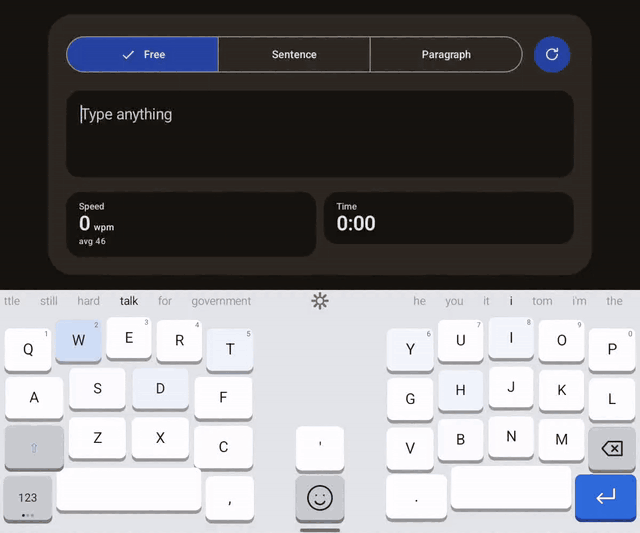

# TailorKeys

An Android keyboard built around two things stock keyboards get wrong: **size you can actually control**, and **predictions that don't fight you**.

TailorKeys has no internet permission. Its own prediction and correction run on the device. Optional system spell checking sends words to your selected spell-checker app, which may use the internet. Optional dictation uses the selected speech service.

## Demo



Typed on a tablet at about 80 words a minute without looking at the keys, in the keyboard's "Try it" screen, with the first autocorrect prototype. Garbled words are fixed a moment later, and some mistakes stay in.

The autocorrect model is still in training. The prototype is retired and not included, so builds from this repository use the keyboard's earlier corrector for now. What the prototype got wrong, and what it taught us, is in [docs/autocorrect-prototype.md](docs/autocorrect-prototype.md).

## Build and install

Needs the Android SDK and JDK 17–24. Gradle 8.14 can't run on JDK 25, which is what current Android Studio bundles. From a terminal, point `JAVA_HOME` at JDK 23 first. In Android Studio, set Settings → Build → Gradle → Gradle JDK to jdk-23.

```
set JAVA_HOME=C:\Program Files\Java\jdk-23
gradlew installDebug
```

Then open the TailorKeys app on the phone and follow the two setup steps.

## Project layout

| File | What it does |
| --- | --- |
| `TailorKeysService.kt` | The input method: commits text, layers and caps, suggestions, learning, auto-caps |
| `KeyboardView.kt` | Draws the suggestion wheels and key grid (full or split, tilt, ergonomic curve), handles touch and swipe keys, and runs the wiggle editor |
| `layout/KeyGrid.kt` | The key grid (5 + center + 5 columns): placement, insert-and-shift, combine, separate, spacebar stretch, saved as JSON |
| `layout/KeyText.kt` | What each key types and shows on the ABC, 123 and #+= layers |
| `Predictor.kt` | Word and symbol suggestions from `assets/words.txt` plus words you type (stored on the phone only) |
| `Theme.kt` | The five themes |
| `KeyboardSettings.kt` | Every setting with its default and range |
| `SettingsActivity.kt` | Setup steps, live "Try it" box, the arrange-keys editor, and all sliders and toggles |

## Roadmap

**Milestone 1: sizing foundation (done)**
- Height, width, left/center/right position and bottom lift, set separately for portrait and landscape
- Key gap, corner radius, label size, spacebar width, bottom row height, optional number row
- Tap the empty side of a narrowed keyboard to move it to that side
- Live preview: the keyboard updates while you drag a slider

**Milestone 2: predictions that don't fight you**
- Two suggestion wheels, one per thumb. The chosen word sits in the middle with its neighbours peeking in, clipped, at both edges; drag to spin, release to snap, tap to insert. The part you've already typed is highlighted in each word. Left is "explore" (more varied, higher temperature), right is "closest" (similar to what you're typing)
- English word list and a personal dictionary that learns from what you type
- Autocorrect off by default. The opt-in mode replaces a word only when it's confident, and one backspace undoes it
- Never learn from password fields; incognito toggle

**Milestone 3: swipe typing**
- Shape-matching gesture decoder over the same dictionary, ranked by your personal word history
- Adjustable sensitivity (how far before a tap becomes a swipe)
- Trail color, width and fade settings; live word preview while swiping

**Milestone 4: gestures**
- Slide on the spacebar to move the cursor; swipe left from backspace to delete whole words
- Assignable swipe gestures (for example, swipe up on a key for its symbol)

**Milestone 5: advanced layout**
- Split layout for tablets: two halves with an adjustable gap and tilt (negative to positive), each half with its own suggestion slot
- One swipe key replaces shift, 123, #+= and ABC. Swiping it up or down cycles ABC, Caps, 123 and #+= and the layout changes immediately and stays there. Tap = one-shot capital on ABC, nothing on other layers
- Rearrange mode (wiggling keys, like a phone home screen): the keyboard is a grid of five columns per side plus a center column (in the split gap; in the full layout it only takes space once used), and any key can be dragged to any empty cell. Spacebars fill their side by default; dropping a key on a spacebar puts it on the spacebar's inner side and the spacebar shrinks outward by one key. Dropping on another key's edge inserts it there and shifts the neighbouring keys over by one, toward whichever side needs fewer moves (a spacebar in the way shrinks instead); dropping on its middle combines them into one swipe key. One swipe moves exactly one face. The default swipe key has three faces (ABC, 123, #+=); caps is folded into ABC: tap for a one-shot capital, double-tap for caps lock, tap again to clear, and the label shows the state (abc, Abc, ABC with highlight). Combined keys can be separated again
- Split layout cuts the same grid down the middle; tilt and curve apply outside rearrange mode. Comma and period live on the numbers layer
- Ergonomic split: halves always sit flush against the screen edges with any extra space in the middle. Columns raised to match finger length, keys angled like a fan, spacebars angled toward the thumbs, plus an adjustable tilt that keeps everything on screen
- Per-key size editor
- Floating keyboard (drag anywhere, resize by corner)

**Milestone 6: chording (experimental)**
- Press several keys together to type a whole word, in the style of chorded keyboards like CharaChorder. Our own chord engine and library, no copied code or data
- Unordered chords, compound chords, and an editable personal chord library
- Needs a prototype first: touchscreens give no key travel, so test it on the split tablet layout where each hand has a fixed position

**Milestone 7: Play Store**
- Release signing, privacy policy, store listing and screenshots
- Accessibility (TalkBack) and translatable strings

## Credits

English, Spanish, German and French word lists: Android Open Source Project (AOSP) LatinIME, Apache License 2.0; see `app/src/main/assets/NOTICE-dictionary.txt`.

Word-pair and word-triple counts: [Tatoeba contributors](https://tatoeba.org/), [CC BY 2.0 FR](https://creativecommons.org/licenses/by/2.0/fr/); English sentence export downloaded 2026-10-15; Spanish, German and French exports downloaded 2026-10-16; see `app/src/main/assets/NOTICE-dictionary.txt`.
